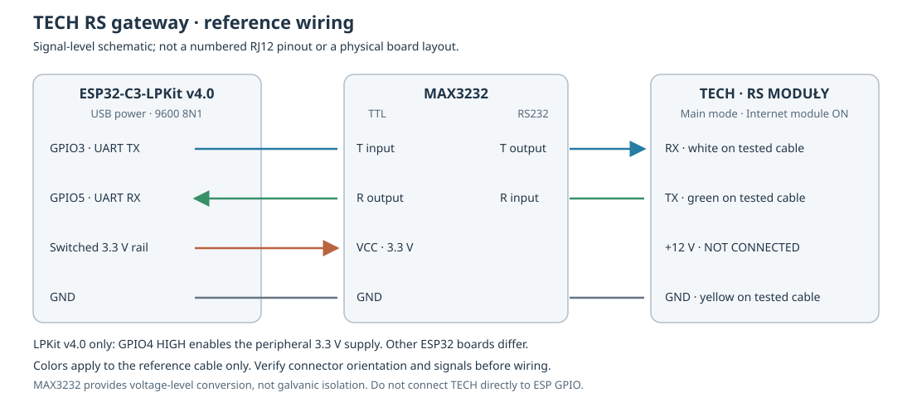
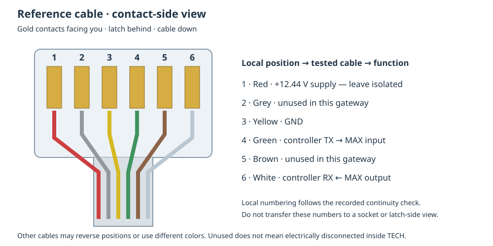
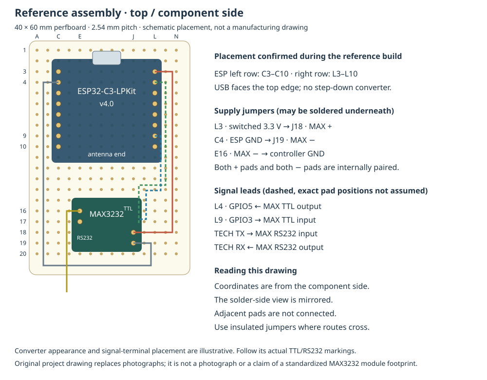

# Hardware

## Reference parts

| Part | Reference / requirements |
|---|---|
| ESP32 board | [LaskaKit ESP32-C3-LPKit](https://github.com/LaskaKit/ESP32-C3-LPKit), specifically v4.0 |
| Serial converter | MAX3232 module supporting 3.3 V supply, with separate TTL and RS232 inputs/outputs |
| Controller cable | Six-position, six-contact modular plug matching the controller; verify continuity and orientation |
| Supply | USB power supply and cable suitable for the ESP board |
| Assembly board | Optional [40 × 60 mm isolated-pad perfboard](https://dratek.cz/arduino-platforma/1376-univerzalni-plosny-spoj-40mm-x-60mm.html), 2.54 mm pitch |
| Wiring | Insulated jumpers; connector/strain relief suited to the enclosure |

The reference MAX3232 module has TTL/RS232 sides, direction arrows and paired
supply pads. A manufacturer part number is not available; identify equivalent
modules by their supply requirements and terminal functions.
The MAX3232 IC name alone does not determine a module's footprint or pin order.
The manufacturer's [MAX3232 datasheet](https://www.ti.com/product/MAX3232) describes
the IC, not the origin of the particular assembled mini-board.

Other ESP32 boards can use configurable GPIO assignments but have not been
physically verified here. There is no step-down converter in this reference
assembly. The following diagrams show its electrical connections and layout.

## Electrical connections



| ESP connection | Converter connection |
|---|---|
| GPIO5, UART RX | TTL receiver output (arrow out of converter) |
| GPIO3, UART TX | TTL transmitter input (arrow into converter) |
| Switched 3.3 V peripheral output | VCC |
| GND | GND, also connected to controller GND |

The signal paths are:

```text
Controller TX → MAX RS232 input → MAX TTL output → ESP GPIO5
Controller RX ← MAX RS232 output ← MAX TTL input ← ESP GPIO3
Controller GND ─ MAX GND ─ ESP GND
```

On LPKit **v4.0**, GPIO4 must be HIGH to enable the switched peripheral supply.
The reference configuration handles this. That is board-specific: do not copy
the power-switch setting blindly to another board. The official
[v4 schematic](https://github.com/LaskaKit/ESP32-C3-LPKit/blob/main/HW/ESP32-C3-LPKit_v4.pdf)
is the source for this board detail.

The tested serial format is **9600 baud, 8N1, no software inversion** through
MAX3232. The converter provides voltage-level conversion, not galvanic isolation.
Do not connect controller serial signals or its supply directly to ESP GPIO.

## Plug orientation and measured reference cable



The illustration uses **local positions 1–6, left to right**, with gold contacts
facing the viewer, latch behind and cable pointing down. These are the positions
used in the diagrams; they are **not vendor pin numbering**.
A socket view or a latch-side view must not be read with
the same left/right assignment.

| Local position | Tested cable color | Established function / use |
|---|---|---|
| 1 | Red | Controller supply, +12.44 V relative to yellow; isolated and unused |
| 2 | Grey | Unused by this assembly |
| 3 | Yellow | Common GND |
| 4 | Green | Controller TX → converter RS232 input |
| 5 | Brown | Unused by this assembly |
| 6 | White | Controller RX ← converter RS232 output |

The reference cable's contact mapping was verified by continuity measurement.
Measured idle voltage on the white wire was approximately +6.7 V relative to
yellow. Reception and confirmed writes verified the TX/RX assignments.

Colors apply only to this cable. Verify contact positions and signal roles for
the connected controller; unused grey/brown wires may still lead to electrically
connected socket contacts. Model-specific documentation is linked from
[compatibility](compatibility.md).

## Reference perfboard layout



Column letters run A–N from left to right; rows 1–20 run downward, viewed from
the component side. The board is 40 mm wide and 60 mm tall.

| Component / net | Position |
|---|---|
| ESP left header | C3–C10 |
| ESP right header | L3–L10 |
| ESP USB | Toward the top edge |
| Converter left supply pair | E16 negative, E17 positive |
| Converter right supply pair | J18 positive, J19 negative |
| 3.3 V jumper | L3 → J18 |
| Ground jumper | C4 → J19 |
| Controller ground | E16 |
| ESP RX / TX | L4 / L9 respectively, to the corresponding TTL terminals |

The converter's two positive pads and its two ground pads were checked for
continuity during assembly. Do not assume another converter board has that
arrangement. Signal leads on the converter are schematic: use its terminal labels
rather than assuming a standardized signal-pad footprint.

All adjacent perfboard pads are isolated. Power jumpers can run underneath;
the underside is mirrored relative to this drawing. Insulated jumpers may cross
without creating an electrical junction. Keep the USB connector accessible and
provide strain relief for the controller cable.

## Power and controller configuration

USB is the documented baseline power source. The controller's supply current
capability has not been established, so the +12 V wire is not used here. No claim
is made that every ESP board can be powered from that port. Wi-Fi logging and OTA
allow USB to be used for power without a permanent PC connection.

Configure the controller for **Main mode**, enable **Internet module**, and use
**RS MODUŁY** (RS MODULY). See [installation](installation.md#required-controller-configuration)
for the required settings and [compatibility](compatibility.md) for available functions.
